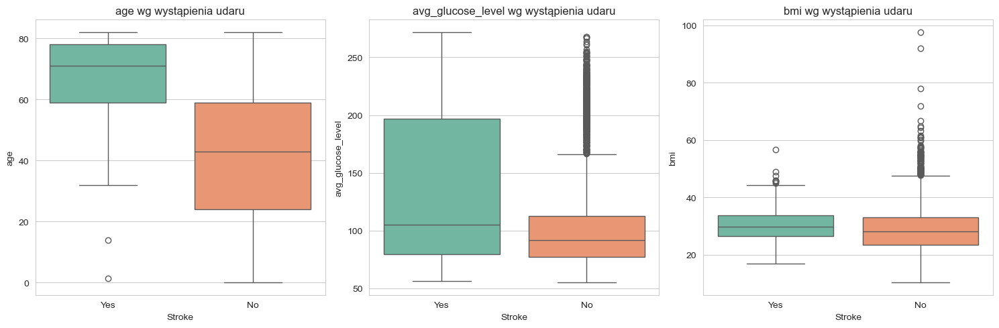
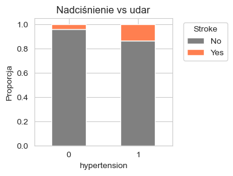

<<<<<<< HEAD
# Stroke Risk Factors – Statistical Analysis in Python

Statistical analysis of the **Stroke Prediction** dataset (5,110 patients, 12 variables), done for the *Statistical Data Analysis* course (MSc in Computer Science, Data Science specialisation, Cracow University of Technology).
The project goes from **exploratory data analysis** to **formal statistical inference**: which patient characteristics are associated with stroke, and are the differences statistically significant?

> Notebooks are in Polish. They are saved with their outputs, so all tables and charts can be viewed directly on GitHub.



## Tech stack
Python · pandas · NumPy · SciPy · statsmodels · scikit-posthocs · Matplotlib · seaborn · Jupyter Notebook

## 1. Exploratory data analysis
📓 [`01_stroke_eda.ipynb`](01_stroke_eda.ipynb)

- Description of all variables (type, cardinality, meaning).
- Data quality: missing BMI values (3.9%) and a check of whether they are random, extreme but plausible values, rare categories (`gender = Other`) and the `Unknown` smoking category (30% of records).
- Descriptive statistics and distributions (histograms, box and violin plots, bar and pie charts).
- **Class imbalance:** only 4.9% of patients had a stroke.
- Group comparisons and relationships: age, glucose and BMI by stroke status; smoking, hypertension, gender and marital status vs stroke.



**Key findings**
- **Age** is the strongest factor: mean age 67.7 years in the stroke group vs 42.0 without a stroke.
- **Glucose level** is higher in patients with a stroke (mean 132.5 vs 104.8 mg/dL), with a second peak around 200–250 mg/dL that probably corresponds to diabetic patients.
- **Hypertension:** stroke is more than 3× more frequent (13.3% vs 4.0%).
- The apparent link between **marriage** and stroke disappears after controlling for age, so it is a **confounding effect**.

## 2. Hypothesis testing and estimation
📓 [`02_stroke_hypothesis_testing.ipynb`](02_stroke_hypothesis_testing.ipynb)

- **Point and interval estimation:** confidence intervals for means (normal approximation) and proportions (Wilson method).
- **Bootstrap** confidence interval for mean glucose (5,000 resamples), compared with the classical interval.
- **Choosing the test from the assumptions:** Shapiro–Wilk (normality, tested on subsamples because the test is oversensitive for large n) and Levene (equal variances).
- **Post-hoc analysis** with Dunn's test after Kruskal–Wallis.

| Research question | Test | Result |
|-------------------|------|--------|
| Does age differ between patients with and without a stroke? | Mann–Whitney U | p < 0.001, median ~71 vs ~43 years |
| Is smoking associated with stroke? | Chi-square test of independence | χ² = 11.49, p ≈ 0.003 |
| Does glucose level differ between work types? | ANOVA + **Kruskal–Wallis** (ANOVA assumptions violated) + Dunn post-hoc | H = 17.30, p ≈ 0.002; children differ from private-sector and self-employed workers |
| What share of patients had a stroke? | Wilson confidence interval | 4.87% (95% CI: 4.32–5.50%) |

<p>


</p>

The bootstrap and classical confidence intervals are almost identical (difference of about 0.01 mg/dL), which confirms the classical result is stable for a sample of this size.

## Possible next steps
- Multivariable analysis (e.g. logistic regression) with age, glucose, BMI, hypertension and smoking together.
- Testing the smoking–stroke association while controlling for age, since part of the effect may come from age differences between groups.

## Data
The dataset is **not included** in this repository. Download it from Kaggle and save it next to the notebooks as `healthcare-dataset-stroke-data.csv`:
[Stroke Prediction Dataset](https://www.kaggle.com/datasets/fedesoriano/stroke-prediction-dataset)

## How to run
```bash
git clone https://github.com/KarolinaKokoszka/stroke-risk-statistical-analysis.git
cd stroke-risk-statistical-analysis
pip install pandas numpy scipy statsmodels scikit-posthocs matplotlib seaborn jupyter
# download the dataset (see Data above)
jupyter notebook
```
=======
# Statistical Data Analysis - Python Projects

Three statistical analysis projects from the **Statistical Data Analysis** course (MSc in Computer Science, Data Science specialisation, Cracow University of Technology).
Together they cover the full statistical workflow on real datasets: **exploratory data analysis → hypothesis testing and estimation → regression modelling with full diagnostics**. Every result comes with an interpretation.

> Notebooks are in Polish. Each notebook is saved with its outputs, so all tables and charts can be viewed directly on GitHub.

## Tech stack
Python · pandas · NumPy · SciPy · statsmodels · scikit-learn · scikit-posthocs · Matplotlib · seaborn · Jupyter Notebook

## Projects

### 1. Exploratory data analysis: stroke risk factors
📓 [`01_stroke_eda.ipynb`](01_stroke_eda.ipynb) · Dataset: Stroke Prediction (5,110 patients, 12 variables)

- Description of all variables (type, cardinality, meaning), analysis of missing BMI values (3.9%) and checking whether they are random, handling of rare and "Unknown" categories.
- Descriptive statistics, distributions (histograms, box and violin plots), class imbalance of the target (only 4.9% of patients had a stroke).
- Group comparisons and relationships: age, glucose and BMI by stroke status; smoking, hypertension, gender and marital status vs stroke.

**Key findings:** age is the strongest factor (mean age 67.7 years with a stroke vs 42.0 without). Stroke is more than 3× more frequent among patients with hypertension. The apparent link between marriage and stroke disappears after controlling for age, so it is a confounding effect.

### 2. Hypothesis testing and estimation: stroke data
📓 [`02_stroke_hypothesis_testing.ipynb`](02_stroke_hypothesis_testing.ipynb) · Dataset: Stroke Prediction

- Point and interval estimation: confidence intervals for means (normal approximation) and proportions (Wilson method), plus a **bootstrap** confidence interval (5,000 resamples) compared with the classical one.
- Choosing the test from the assumptions: Shapiro-Wilk (normality), Levene (equal variances).
- Hypothesis tests:

| Research question | Test | Result |
|-------------------|------|--------|
| Does age differ between patients with and without a stroke? | Mann-Whitney U | p < 0.001, median ~71 vs ~43 years |
| Is smoking associated with stroke? | Chi-square test of independence | χ² = 11.49, p ≈ 0.003 |
| Does glucose level differ between work types? | ANOVA + **Kruskal-Wallis** (ANOVA assumptions violated) + Dunn post-hoc | H = 17.30, p ≈ 0.002, children differ from private sector and self-employed |
| What share of patients had a stroke? | Wilson confidence interval | 4.87% (95% CI: 4.32-5.50%) |

### 3. Linear regression: simple and multiple
📓 [`03_linear_regression.ipynb`](03_linear_regression.ipynb)

**a) Simple linear regression: power plant output vs ambient temperature**
Dataset: Combined Cycle Power Plant (UCI, 9,568 observations)
- OLS model `PE ~ AT`, significance of coefficients and confidence intervals.
- Full assumption checks: normality of residuals (Shapiro-Wilk, QQ-plot), residual trend (LOWESS), homoscedasticity (Scale-Location), autocorrelation (Box-Pierce), extrapolation range.
- Outliers (standardised residuals) and influential observations (**Cook's distance**). The model was refitted without the 416 influential points.
- **5-fold cross-validation**: train and test R² almost identical (0.9196 vs 0.9195), so no overfitting.
- **Result:** R² improved from **0.899 to 0.920** and RSE dropped from 5.43 to 4.78 MW. Each +1 °C lowers output by about 2.2 MW.

**b) Multiple linear regression: diabetes progression**
Dataset: Diabetes (442 patients, 9 predictors, unscaled version)
- Correlation analysis and detection of **multicollinearity** (S1-S2 r = 0.90, condition number 7,190, VIF).
- Assumption checks, including the **Breusch-Pagan** test (heteroscedasticity detected).
- **Feature selection:** VIF elimination, forward and backward stepwise regression, compared by AIC and adjusted R².
- Influential observations: Cook's distance, **DFBETAS**, **DFFITS**, studentised residuals.
- **Result:** the 5-variable model (BMI, BP, S1, S2, S5) matches the full 9-variable model (adj. R² 0.493 vs 0.490) with lower AIC. After removing influential observations R² rose from 0.501 to 0.552.

## Data
Datasets are **not included** in this repository. To run the notebooks, download them and place them next to the notebooks, using these paths:

| Path | Source |
|------|--------|
| `healthcare-dataset-stroke-data.csv` | [Stroke Prediction Dataset (Kaggle)](https://www.kaggle.com/datasets/fedesoriano/stroke-prediction-dataset) |
| `CCPP/Folds5x2_pp.xlsx` | [Combined Cycle Power Plant (UCI)](https://archive.ics.uci.edu/dataset/294/combined+cycle+power+plant) |
| `diabetes.tab.txt` | [Diabetes Dataset, unscaled (Kaggle)](https://www.kaggle.com/datasets/antoniofurioso/diabetes-dataset-sklearn) |

>>>>>>> 361481d749617ead0c553f9b862a4704e587a810
